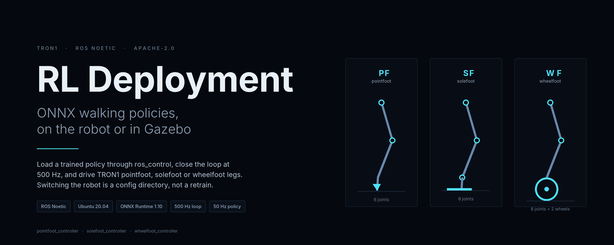
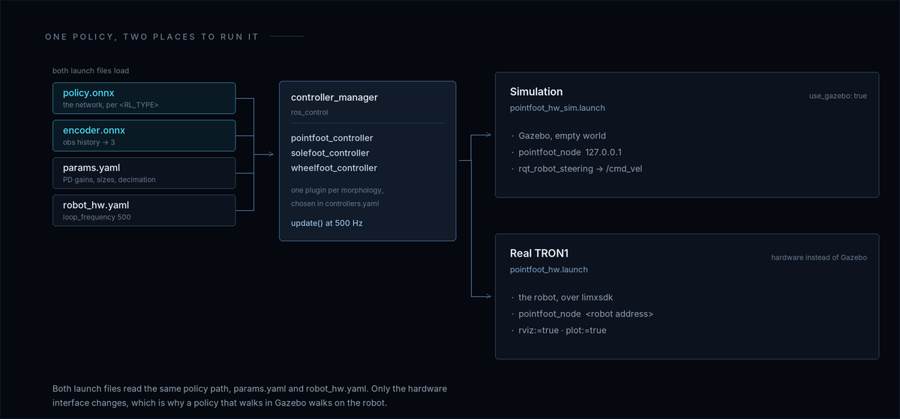
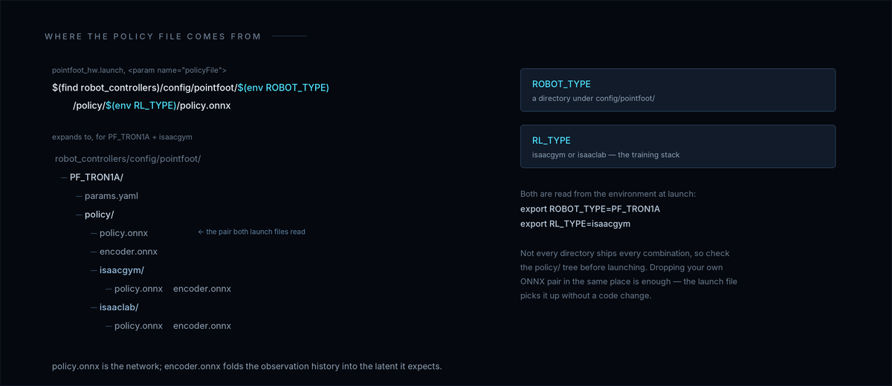
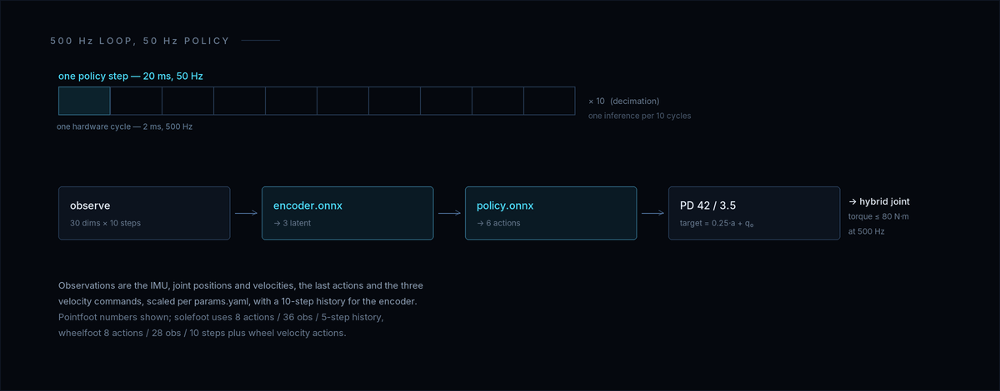

<p align="center">
  
</p>

<p align="center">
  <a href="README.md">English</a> | <b>中文</b>
</p>

<p align="center">
  <a href="LICENSE"></a>
  
  
  
</p>

# TRON1 RL 部署 — ROS Noetic

> 🧭 **TRON1 开源生态的一部分。** TRON1 全部开源仓库和上手路线：[TRON1 开源生态](https://github.com/limxdynamics/tron1-rl-isaacgym/blob/master/README_cn.md#tron1-开源生态)。

将训练好的强化学习（RL）行走策略部署到 TRON1 双足和轮足机器人上。通过 `ros_control` 加载 ONNX 模型，在 Gazebo 仿真或真机上运行。

## 工作原理

<p align="center">
  
</p>

<p align="center"><sub>两个 launch，同一份策略；差别只在硬件接口。</sub></p>


启动文件会根据 `ROBOT_TYPE` 和 `RL_TYPE` 环境变量，自动从 `robot_controllers/config/pointfoot/<ROBOT_TYPE>/policy/<RL_TYPE>/` 加载 ONNX 策略。

## 1. 前提条件

- Ubuntu 20.04
- ROS Noetic（`ros-noetic-desktop-full`）
- ONNX Runtime 1.10.0

### 安装 ROS 依赖

```bash
sudo apt-get update
sudo apt install ros-noetic-urdf ros-noetic-kdl-parser ros-noetic-hardware-interface \
    ros-noetic-controller-manager ros-noetic-controller-interface ros-noetic-ros-control \
    ros-noetic-gazebo-* ros-noetic-robot-state-* ros-noetic-joint-state-* \
    ros-noetic-rqt-gui ros-noetic-rqt-controller-manager ros-noetic-plotjuggler* \
    cmake build-essential libpcl-dev libeigen3-dev libopencv-dev libmatio-dev \
    python3-pip libboost-all-dev libtbb-dev liburdfdom-dev liborocos-kdl-dev -y
```

### 安装 ONNX Runtime

```bash
wget https://github.com/microsoft/onnxruntime/releases/download/v1.10.0/onnxruntime-linux-x64-1.10.0.tgz
tar xvf onnxruntime-linux-x64-1.10.0.tgz
sudo cp -a onnxruntime-linux-x64-1.10.0/include/* /usr/include
sudo cp -a onnxruntime-linux-x64-1.10.0/lib/* /usr/lib
```

## 2. 编译

```bash
mkdir -p ~/limx_ws/src && cd ~/limx_ws/src
git clone https://github.com/limxdynamics/limxsdk-lowlevel.git
git clone https://github.com/limxdynamics/tron1-gazebo-ros.git
git clone https://github.com/limxdynamics/robot-description.git
git clone https://github.com/limxdynamics/robot-visualization.git
git clone https://github.com/limxdynamics/tron1-rl-deploy-ros.git

cd ~/limx_ws
catkin_make install
source install/setup.bash
```

## 3. 运行仿真

### 设置机器人型号和训练环境

可用机器人型号 —— `robot_controllers/config/pointfoot/` 下每个目录是一种：

| 机型 | `ROBOT_TYPE` | 关节数 |
| --- | --- | --- |
| Pointfoot，双足点足 | `PF_P441A`、`PF_P441B`、`PF_P441C`、`PF_P441C2`、`PF_TRON1A`、`PF_TRON1B` | 6 |
| Solefoot，双足平足 | `SF_TRON1A`、`SF_TRON1B` | 8 |
| Wheelfoot，双足轮足 | `WF_TRON1A`、`WF_TRON1B` | 8（6 关节 + 2 轮） |

`A` 与 `B` 是同一机型的两种结构版本：关节布局与 `params.yaml` 里的控制参数完全一致，只有 `robot-description` 里的网格不同。

支持训练环境：`isaacgym`、`isaaclab`

```bash
echo 'export ROBOT_TYPE=PF_P441A' >> ~/.bashrc
echo 'export RL_TYPE=isaacgym' >> ~/.bashrc
source ~/.bashrc
```

每个 `<ROBOT_TYPE>` × `<RL_TYPE>` 组合都带预训练策略对。三个 `B` 版本——`PF_TRON1B`、`SF_TRON1B`、`WF_TRON1B`——没有顶层 `policy/` 那对文件，而 `controller_sim.launch` 读的正是它；这三型请设好 `RL_TYPE`，用 `pointfoot_hw.launch` 或 `pointfoot_hw_sim.launch`。要换成自己的策略见[部署自有策略](#5-部署自有策略)。

<p align="center">
  
</p>

<p align="center"><sub><code>ROBOT_TYPE</code> 与 <code>RL_TYPE</code> 展开成文件路径；你自己的 ONNX 也放在同一个目录结构里。</sub></p>


### 启动

```bash
source ~/limx_ws/install/setup.bash
roslaunch robot_hw pointfoot_hw_sim.launch
```

此命令会启动 Gazebo 中的机器人，加载 ONNX RL 策略并开始推理，机器人应自动开始行走。

### 启动参数

| 参数 | 默认值 | 说明 |
|------|---------|------|
| `plot` | `false` | 设为 `true` 开启 PlotJuggler 数据可视化 |

## 4. 部署到真机

```bash
source ~/limx_ws/install/setup.bash
roslaunch robot_hw pointfoot_hw.launch
```

与仿真相同，加载同样的 ONNX 策略，但直接与真机通信。

设置 `rviz:=true` 开启 RViz 可视化：

```bash
roslaunch robot_hw pointfoot_hw.launch rviz:=true
```

## 5. 部署自有策略

将训练好的 ONNX 文件放到指定路径：

```
robot_controllers/config/pointfoot/<ROBOT_TYPE>/policy/<RL_TYPE>/
    policy.onnx
    encoder.onnx
```

然后正常启动，你的策略就会被自动加载。

<p align="center">
  
</p>

<p align="center"><sub>控制器每 20 ms 做的事：观测进，关节目标出。</sub></p>


## 6. 相关仓库

- [tron1-mujoco-sim](https://github.com/limxdynamics/tron1-mujoco-sim) — 基于 MuJoCo 的策略验证仿真
- [tron1-rl-deploy-python](https://github.com/limxdynamics/tron1-rl-deploy-python) — Python 版 RL 部署
- [tron1-rl-deploy-ros2](https://github.com/limxdynamics/tron1-rl-deploy-ros2) — ROS 2 Iron 版本
- [tron1-robot-description](https://github.com/limxdynamics/tron1-robot-description) — URDF/Xacro 机器人模型
